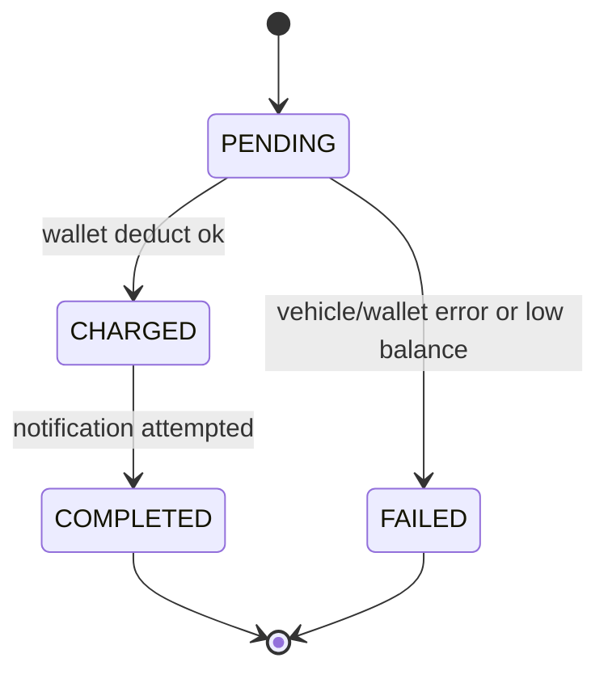

# Toll Transaction Service Design

## State machine (BR4)

## Business rule
| ID | Rule | Enforced in | Tests |
|---|---|---|---|
| BR4 | A crossing only moves PENDING to CHARGED to COMPLETED, or PENDING to FAILED; COMPLETED and FAILED never change | conditional UPDATE in state_machine.transition | test_br4_* |

## ER
crossings(id PK, vehicle_id, gate_id, wallet_id, amount, status, failure_reason, timestamps)
crossing_status_history(id PK, crossing_id FK, status, reason, created_at). One crossing has many history rows.

## Design notes
- The crossing id is used as the wallet reference_id, so the wallet's unique key is a second guard against double charging.
- Notification is best effort: a notification failure never fails a crossing, because the money has already moved.
- Failed crossings are kept for audit, with a failure_reason.