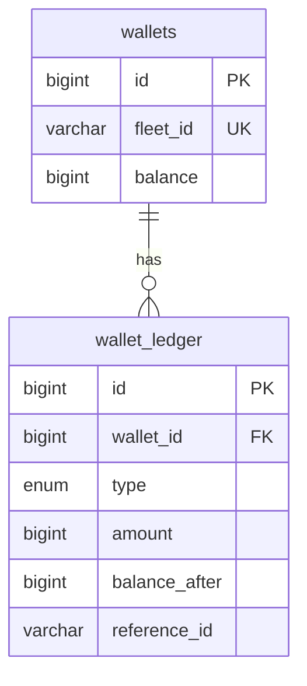

# Wallet Service Design

## ER diagram

## Business rules
| ID | Rule | Enforced in | Test |
|---|---|---|---|
| BR1 | Wallet balance can never go below zero | atomic UPDATE with `balance >= :amount` + CHECK constraint (service.deduct, schema.sql) | test_br1_balance_never_negative |
| BR2 | Every balance change has exactly one ledger entry, in the same transaction | service.topup / service.deduct | test_br2_one_ledger_entry_per_balance_change |
| BR3 | A reference_id can only be posted once per type; repeats return the original result | unique key uq_wallet_type_ref + replay handling | test_duplicate_reference_is_replayed_not_double_charged |

## Endpoints
See docs/contract.md.

## Challenge 1
- Problem: read-check-write lets parallel requests overdraw the wallet.
- Solution: single conditional UPDATE, row count decides success, ledger row in same transaction.
- Why it works: UPDATE takes a row lock, so concurrent requests queue and each sees the latest balance.
- Alternative considered: SELECT ... FOR UPDATE then update (more round trips, same guarantee).
- Evidence: evidence/challenge1/
- Limits: see evidence/challenge1/README.md